# RightClip


RightClip is for the small change you want to make without starting a video project. The file is already sitting in a folder. Pull a clip out of it, drop a track, fix a title or a rotation, or clear the metadata. Right-click the file, choose **RightClip**, and pick the command. Three clicks, and you are on the job. RightClip writes a new file next to the original and leaves the original where it is.

**Trim video**, **Edit tracks**, **Video details**, and **Remove Metadata** are the four commands. Each video opens in its own window. Remove Metadata starts as soon as you choose it. The others open the file so you can make the change and write it out.

When the edit is bigger than that, use a fuller tool. Building a sequence, cutting between shots, adding titles and effects, or finishing a video the way Clipchamp and professional editors do is their work. RightClip stays in File Explorer for the quick one.

- [Install](#install)
- [Trim a video](#trim-a-video)
- [Edit audio tracks and subtitles](#edit-audio-tracks-and-subtitles)
- [Change tags, chapters, and rotation](#change-tags-chapters-and-rotation)
- [Remove metadata](#remove-metadata)
- [While a file is written](#while-a-file-is-written)
- [Settings](#settings)
- [Files RightClip writes](#files-rightclip-writes)

## Install

RightClip runs on 64-bit Windows. Download [RightClip-1.0.0-beta-win-x64-Setup.exe](https://github.com/joelst/rightclip/releases/tag/v1.0-beta) from the v1.0-beta release and run it. The setup includes its own .NET runtime, so there is nothing else to install.

The setup window asks for these choices:

- **Install location.** The default is `%LocalAppData%\Programs\RightClip`.
- **Add RightClip video commands to File Explorer.** Leave this on to get the right-click menu.
- **Use the modern Windows 11 RightClip submenu.** Leave this on for the Windows 11 flyout. Windows 10 can use the legacy menu instead.
- **Create a Start Menu shortcut.**

Choose **Install**. When it finishes, the window says **Install successful!** and offers **View log** and **Exit**. A normal install needs no administrator approval.

The published setup is signed. A development build can offer **Trust the development certificate for all users in Local Computer > Trusted People**. Windows asks for administrator approval only for that choice. Cancelling the approval leaves trust unchanged.

No restart is required. The commands appear on the next right-click. After an upgrade, a running Explorer can keep the previous menu loaded. If the commands look old, restart **Windows Explorer** from Task Manager. Leave Windows itself running.

Uninstall **RightClip** from **Settings > Apps > Installed apps**.

### Install from the ZIP

Download `RightClip-1.0.0-beta-win-x64.zip` from the same release and extract it. You can run `RightClip.exe` from that folder without adding the Explorer menu. To add the legacy menu for the current user, run:

```powershell
pwsh -File .\Install-RightClip.ps1
```

`Uninstall-RightClip.ps1` removes that registration. Building and scripted setup options are in the [developer guide](docs/DEVELOPMENT.md).

## Trim a video

Right-click one or more videos and choose **RightClip > Trim video**. Each file opens in its own window, already loaded.

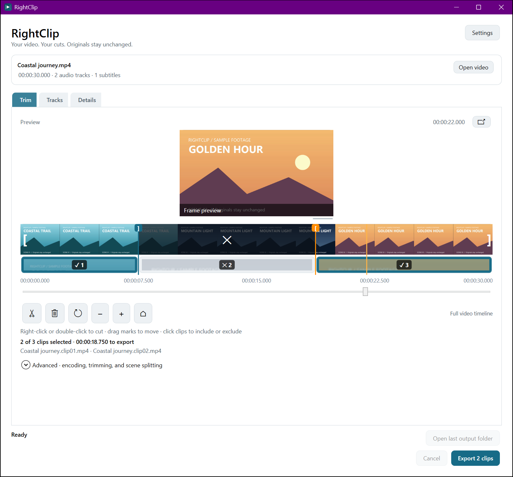

The thumbnail strip is the whole video. Drag along it to move the preview. The time beside the preview is the frame you are seeing. The filename stays outside the picture.

- **Add a cut** with the scissors icon, a double-click, or **Add cut here** on the timeline's right-click menu. Drag a mark to move it. Remove a mark with the remove-cut icon, the Delete key, or the mark's menu.
- Right-click a cut mark to include or exclude the piece on either side. That still works when a piece is only one frame wide.
- Click a piece to keep it or leave it out. A kept piece shows a check. An excluded piece is dimmed and shows a cross. Brackets show where the kept footage starts and ends.
- **Export clip** or **Export N clips** writes each kept piece as its own new file. The button name follows the number of kept pieces.

Arrow keys move a selected cut by a small step. **−**, **+**, and **Fit**, or Ctrl+mouse wheel, zoom the timeline so a short ending is easier to mark. Panning and zooming change the view only. Cut times stay put.

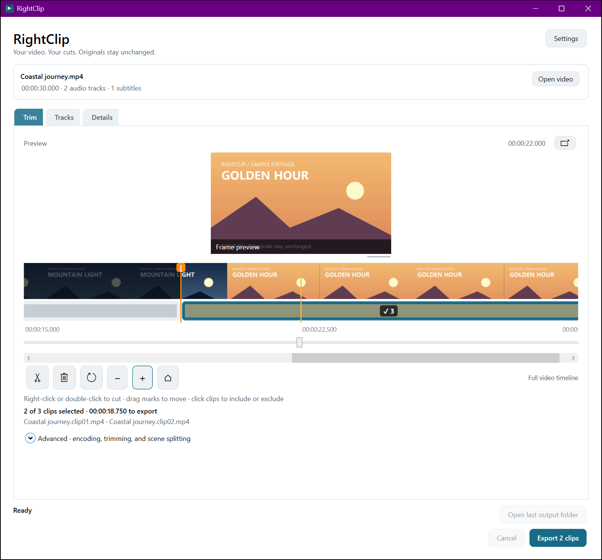

The inline preview follows the video's shape. Drag its handle, or use the Up and Down keys while the handle is focused, to change its height. In a short window the preview collapses so the timeline and **Export** stay reachable. The handle's row keeps its height while the handle is hidden.

The pop-out icon opens the preview in its own resizable window. The inline picture collapses until that window closes.

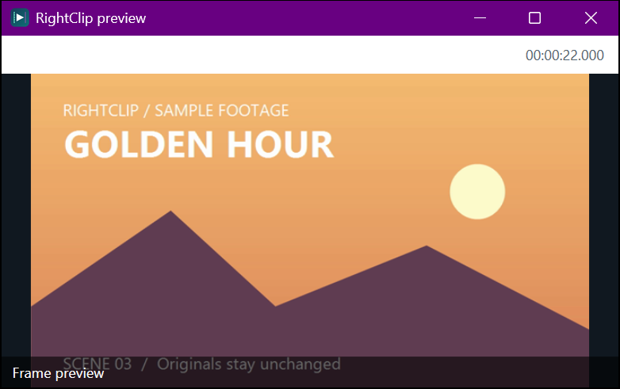

**Open video** replaces the file in this window. It does not add another file to a batch. Select several videos in Explorer when you want one window each.

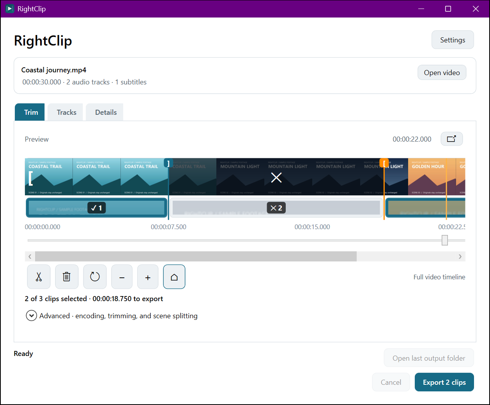

### Accurate cuts and fast copy

Open **Advanced · encoding, trimming, and scene splitting** for the cut mode.

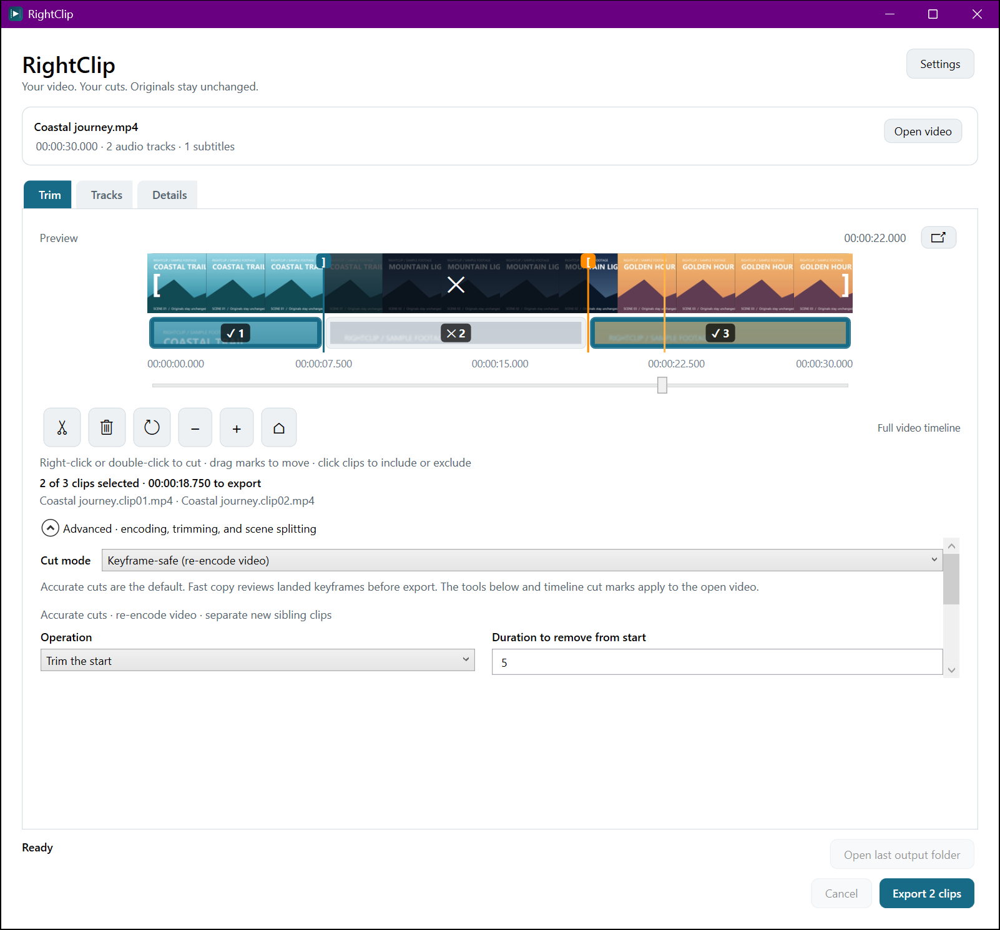

**Keyframe-safe (re-encode video)** is the default. The new clip starts at the frame you chose, and that frame is a fresh keyframe. Audio, soft subtitles, tags, and chapters come along. The included build can re-encode H.264, HEVC, VP8, VP9, AV1, MPEG-4, MPEG-2, and MJPEG. Another video codec stops with an error and leaves the original alone.

**Fast stream copy** keeps the encoded video as it is. A start time snaps to the previous keyframe. RightClip shows the landed time before it writes.

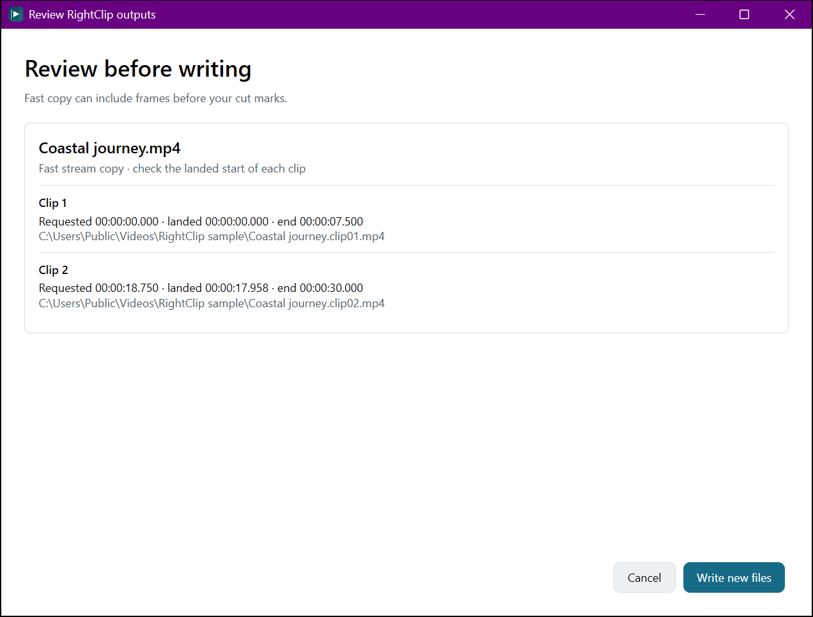

Choose **Write new files** to continue, or **Cancel** to return to the editor.

### Start, end, and range

The same Advanced panel can trim the start, trim the end, or keep a range. Times can be seconds (`12.5`), minutes and seconds (`02:15`), or hours, minutes, and seconds (`01:02:03.500`). A clock time is accepted only when the open video is at least that long. A duration offset applies to the video you have open.

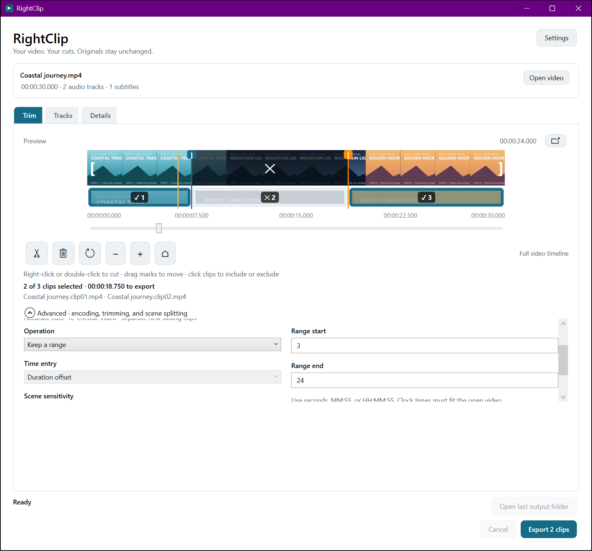

**Review trim / scene operation** shows the planned file before anything is written.

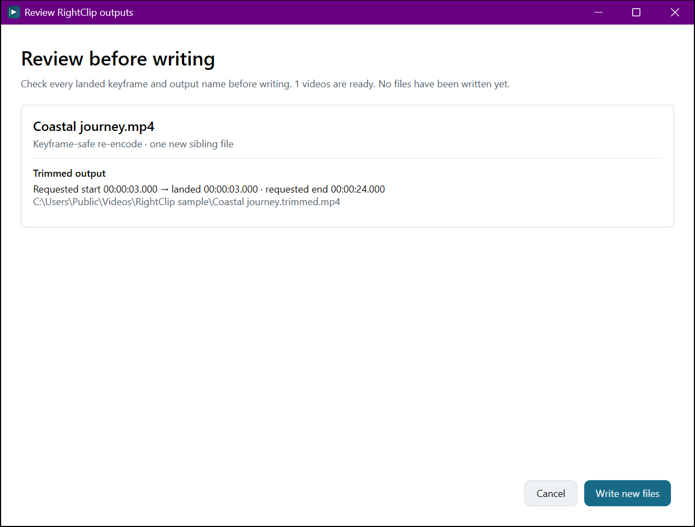

### Split on scene changes

Choose **Split on scene changes**, then **Review trim / scene operation**. RightClip shows thumbnails and the clip count first. The sensitivity used for that review is the saved one. Preparing the review also picks up a newer saved FFmpeg folder or sensitivity from another RightClip window.

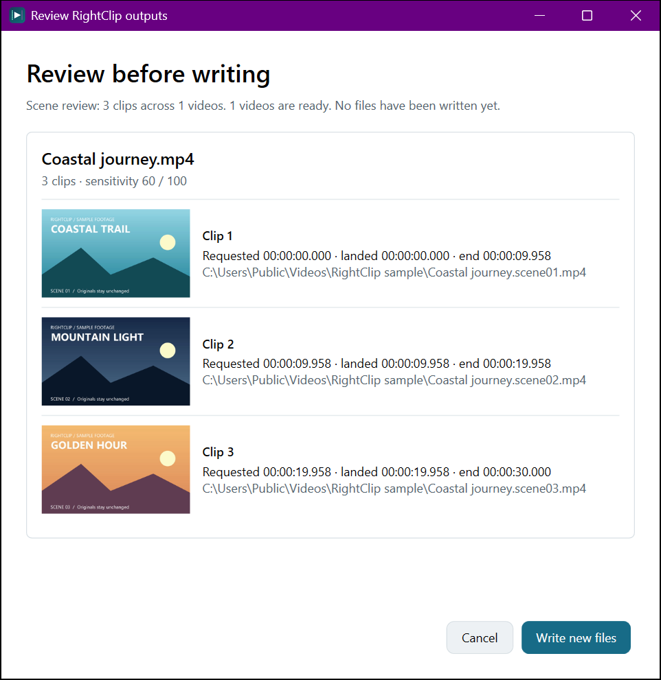

Change the saved sensitivity in **Settings**.

## Edit audio tracks and subtitles

Choose **RightClip > Edit tracks**.

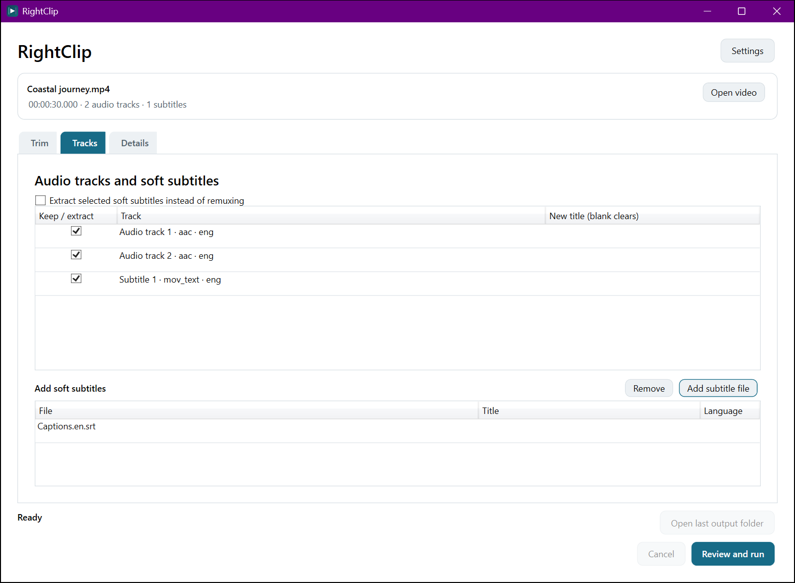

You can keep, drop, or rename audio tracks. Existing soft subtitles can stay or be dropped. **Add subtitle file** accepts SRT, ASS/SSA, WebVTT, or a Matroska subtitle file, with an optional title and language.

Soft subtitles are copied or converted as subtitle tracks. This version leaves them out of the picture itself.

To pull subtitles out as their own files, turn on **Extract selected soft subtitles instead of remuxing**, then **Review and run**.

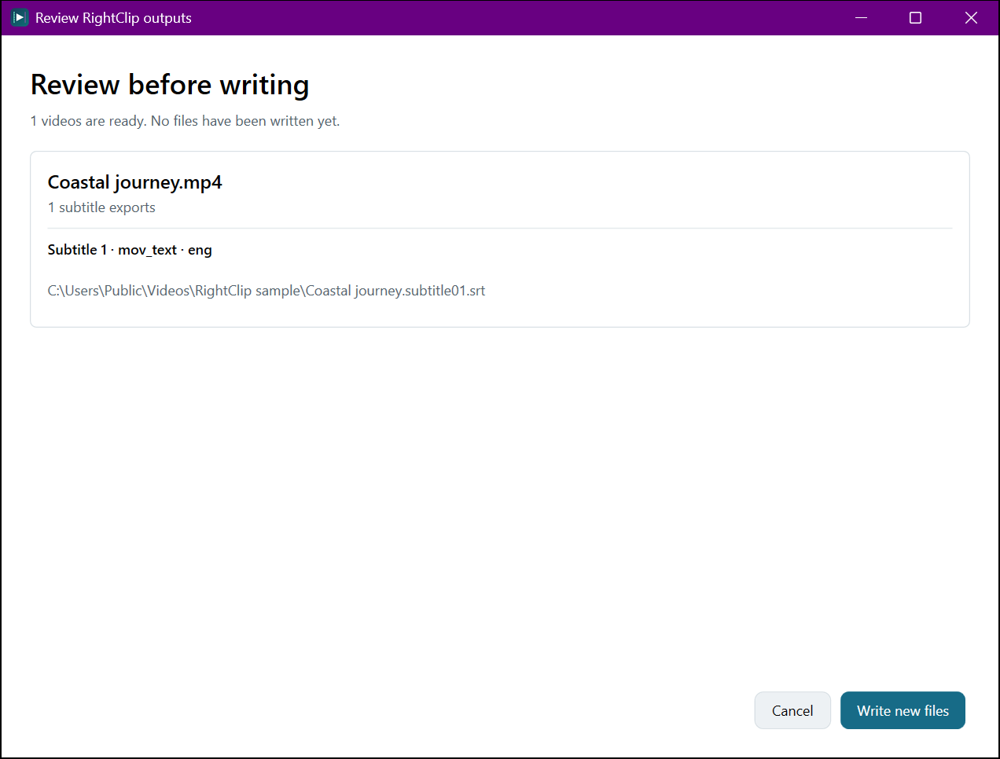

SubRip and other plain text subtitles are written as SubRip (`.srt`). SubStation Alpha stays `.ass`, and WebVTT stays `.vtt`. Any other subtitle, including a bitmap subtitle, is written as a Matroska subtitle file (`.mks`). The new file is named like `video.subtitle01.srt` and sits beside the source.

## Change tags, chapters, and rotation

Choose **RightClip > Video details**.

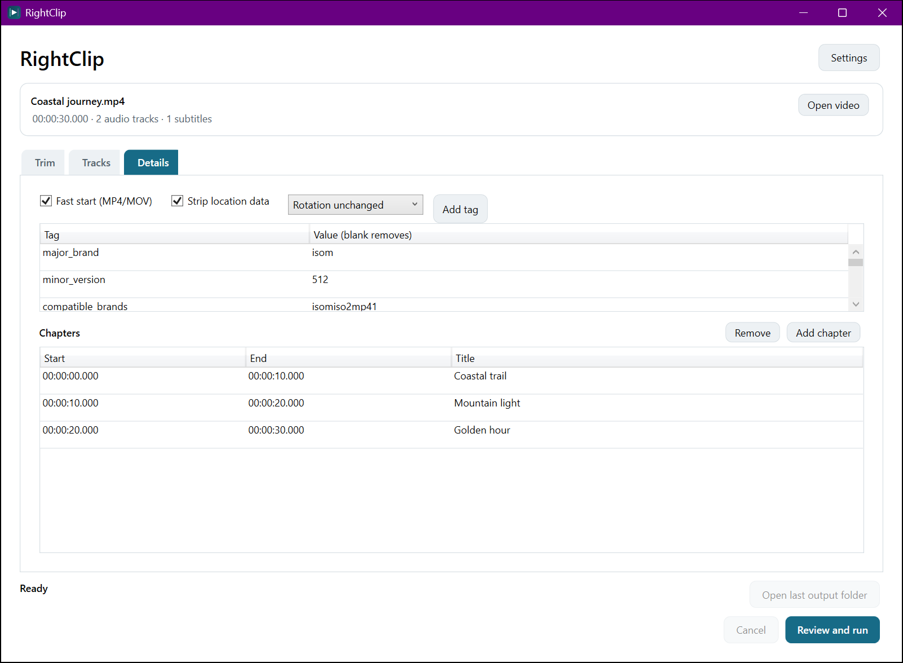

Edit tags and chapters, and set rotation to unchanged, 0°, 90°, 180°, or 270°. **Fast start (MP4/MOV)** moves the index so those files can start playing before they finish downloading. **Strip location data** removes location tags. **Review and run**, then **Write new files**, remuxes a new sibling.

## Remove metadata

**RightClip > Remove Metadata** starts immediately. There is no review step.

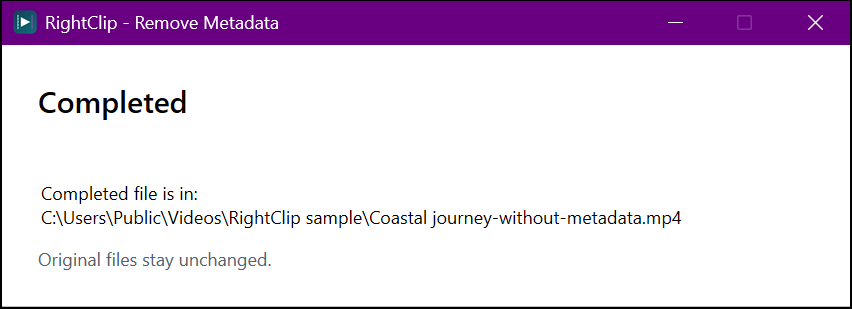

The new file uses a `-without-metadata` name, such as `video-without-metadata.mp4`. File tags, track tags, chapters, and rotation are cleared. Video, audio, and soft subtitles are copied. Fields the container needs in order to play, and metadata stored inside the encoded picture or sound, can remain. Clearing rotation can change how a player displays the video.

## While a file is written

Exporting and re-encoding hide the editor and show a progress window with the current file and percentage.

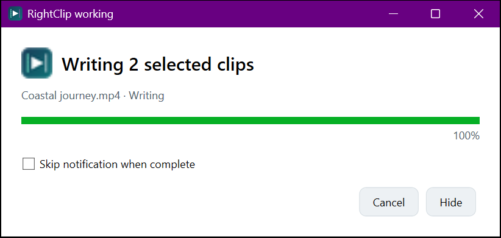

**Hide** hides both windows and closes RightClip when the work finishes, including after a failure. **Skip notification when complete** remembers your choice and closes RightClip after a fully successful write. A failure or a cancellation stays on screen.

Otherwise the window changes to the completed summary.

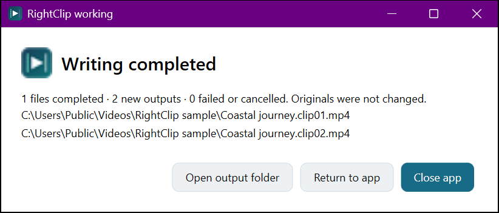

**Open output folder** opens the folder that received the new files. **Return to app** brings the editor back, including a window that was maximized. **Close app** exits. Those buttons stay reachable when the progress window is resized.

If several clips are being written and you cancel, or one of them fails, finished clips from that export are removed. The original video remains.

## Settings

**Settings** in the editor sets an optional FFmpeg folder and the saved scene sensitivity.

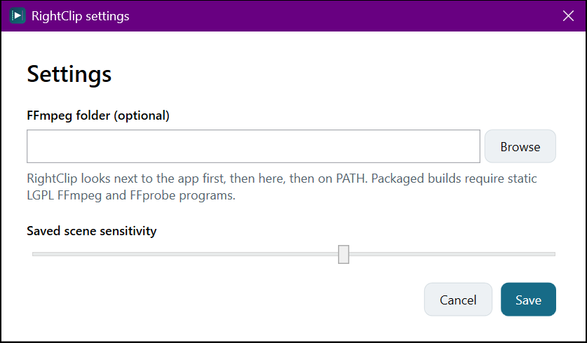

RightClip looks for `ffmpeg.exe` and `ffprobe.exe` in this order:

1. the folder that contains RightClip;
2. the folder you set here;
3. `PATH`.

An installed copy uses the first location. You can leave the folder blank.

## Files RightClip writes

Every result is a new file next to the source. A video result keeps the source extension. An extracted subtitle uses the extension for its format. Existing files stay in place, and a source is never overwritten by its own output. If a name is already taken, RightClip adds a number, such as `video.clip01 (2).mp4`.

The pictures in this guide use a generated sample named Coastal journey. The folder in those pictures is only where that sample lived. A file you open is left where it is, and the new file is written beside it.

| Command | Example |
| --- | --- |
| Trim, one piece per export | `video.clip01.mp4`, `video.clip02.mp4` |
| Trim a start, end, or range | `video.trimmed.mp4` |
| Split on scene changes | `video.scene01.mp4` |
| Edit tracks | `video.tracks.mp4` |
| Extract soft subtitles | `video.subtitle01.srt` |
| Video details | `video.details.mp4` |
| Remove Metadata | `video-without-metadata.mp4` |

Supported sources are MP4, MOV, MKV, and WebM. If the container and codec cannot be copied or re-encoded as requested, RightClip reports that and leaves the original unchanged.

**Open last output folder** in the editor opens the folder from the most recent successful write.

## If Windows blocks the save

RightClip keeps the original and the cuts you already marked, and the window explains how to retry.

Check that you can create files in that folder. If **Controlled folder access** blocked the write, allow `RightClip.exe` and the bundled `ffmpeg.exe` under **Windows Security > Virus & threat protection > Ransomware protection > Allow an app through Controlled folder access**, then retry.

## License

RightClip's own code is [MIT](LICENSE), copyright (c) 2026 Joel Stidley.

The install folder also contains `ffmpeg` and `ffprobe`. Those are separate programs under the LGPLv2.1 or later, with their matching source and license texts. See [NOTICE.md](NOTICE.md).

## Help

Questions about installing and using RightClip start here. Report a bug or a request through [SUPPORT.md](SUPPORT.md). Report a vulnerability privately through [SECURITY.md](SECURITY.md).

Building, testing, and packaging are in the [developer guide](docs/DEVELOPMENT.md).
